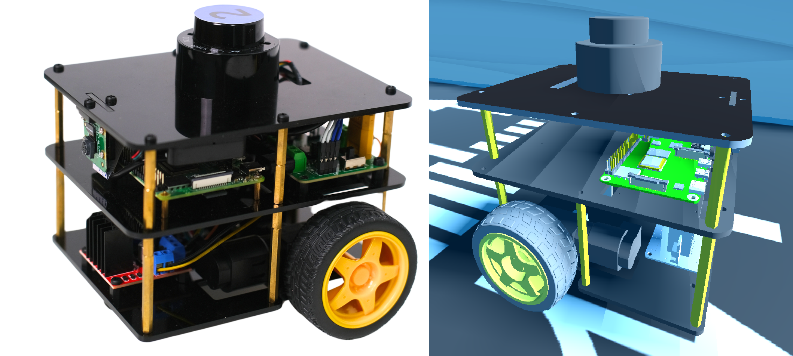
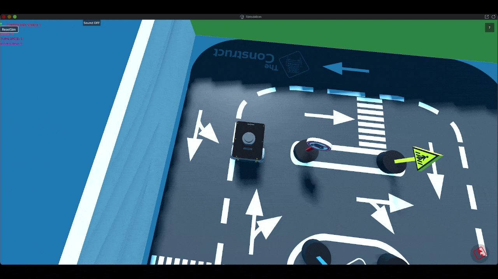
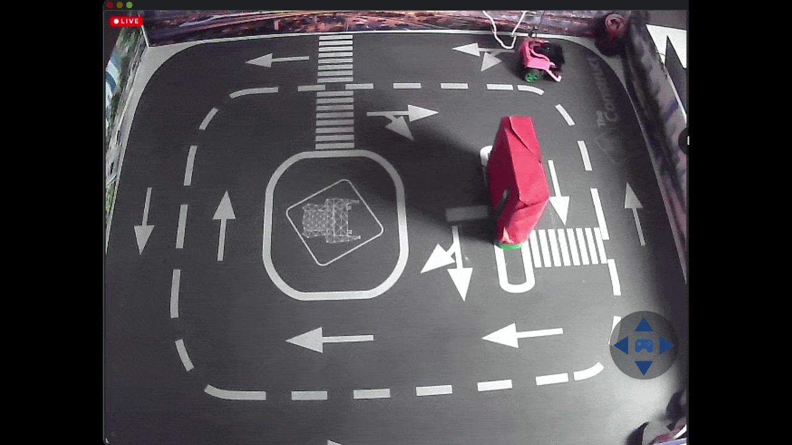
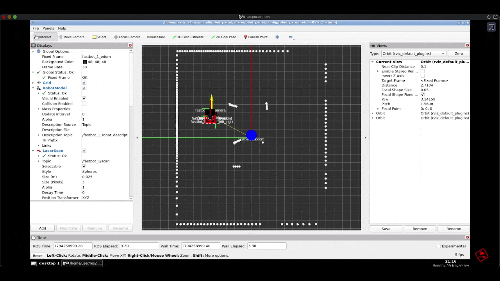

# ROS 2 Robot Patrol

A patrol system for a mobile robot which implements simple obstacle avoidance. The robot used in the project is a [FastBot](https://www.theconstruct.ai/fastbot/) from **The Construct**. It uses LiDAR data to detect obstacles, choose a safe direction, and control robot movement. The project includes a simulation setup and a separate branch *real-robot* adapted for a real robot.

<p align="center">
  
  <br/>
  <strong>FastBot</strong>
  <br/>
</p>

## Features

- Continuously patrols while avoiding obstacles detected by the LiDAR.
- Supports direct, topic-based control and a service-based patrol controller.
- Includes RViz configurations for visualizing the robot and its sensor data.

<!-- Add a short obstacle-avoidance GIF at docs/images/obstacle-avoidance.gif. -->
<!--  -->


## ROS 2 components

- **Nodes:** Patrol controller, direction service, and service client.
- **Topics:** Laser scan input (`sensor_msgs/msg/LaserScan`) and velocity commands (`geometry_msgs/msg/Twist`).
- **Service:** Custom `GetDirection` service analyzes a laser scan and returns a movement direction.
- **Visualization:** RViz.

<!-- Add a lab photo or real-robot patrol GIF at docs/images/real-robot.gif. -->
<!--  -->


<p align="center">
  
  <br>
  <strong>Patrol in Simulation</strong>
</p>

<p align="center">
  
  <br>
  <strong>Patrol in real environment</strong>
</p>

<p align="center">
  
  <br>
  <strong>Rviz Visualization</strong>
</p>

## Build and run

Requirements: ROS 2, `colcon`, and the FastBot simulation for the `main` branch.

Build from the root of your ROS 2 workspace:

```bash
colcon build
source install/setup.bash
```

Start the FastBot simulation, then launch either patrol controller:

**Direct topic-based patrol**

```bash
ros2 launch robot_patrol start_patrolling.launch.py
```

**Service-based patrol**

```bash
ros2 launch robot_patrol main.launch.py
```

Both launch files start RViz.
